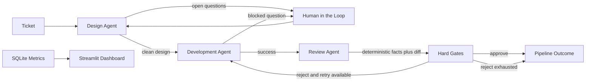
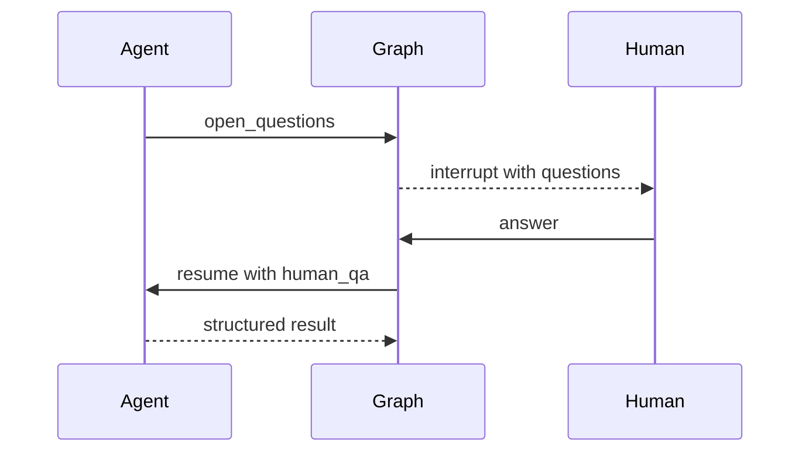

# SDLC Multi-Agent Automation Suite

Prototype automation for a credit-risk engineering workflow: ticket, design, development, review, and evaluation. The system uses structured Pydantic handoffs, deterministic repository checks, LangGraph orchestration, SQLite metrics, and a Streamlit dashboard.

## Setup

Requirements: Python 3.11+ and a virtual environment.

```powershell
py -3.11 -m venv .venv
.venv\Scripts\Activate.ps1
python -m pip install -e ".[dev]"
Copy-Item .env.example .env
```

Set `ANTHROPIC_API_KEY` or `OPENAI_API_KEY` in `.env` for real model calls. Offline tests and scripted evaluations do not require an API key.

## Commands

Run the test suite and baseline verification:

```powershell
python -m pytest
python scripts/verify_repo.py
```

Run an individual design or full pipeline command with a configured provider:

```powershell
python -m sdlc_agents.cli design T5
python -m sdlc_agents.cli run T1
python -m sdlc_agents.cli run T5 --interactive
```

Run the offline evaluation harness:

```powershell
python -m sdlc_agents.cli eval isolated --agent design --repeats 1
python -m sdlc_agents.cli eval isolated --agent dev --repeats 1
python -m sdlc_agents.cli eval isolated --agent review --repeats 1
python -m sdlc_agents.cli eval e2e --repeats 1
python -m sdlc_agents.cli eval report
```

Start the dashboard:

```powershell
python -m streamlit run dashboard/app.py
```

The dashboard reads `metrics.db` by default. Its sidebar can select another SQLite database.

## Architecture



Agents communicate through validated Pydantic models. Repository facts such as diffs, coverage, naming, test results, and test tampering are computed by code; the LLM interprets those facts and produces structured decisions.

## Human in the Loop

HITL is used when an agent cannot safely continue without a human decision. The graph pauses with the agent name, questions, and round number. A human answer is appended to `human_qa`, the round is recorded in SQLite, and the graph resumes at the agent that asked.



Blank answers and `I don't know.` count toward the two-round cap. If the cap is reached, the pipeline ends with `needs_human_unresolved`.

## Evaluation Results

The final offline Phase 8 batch used one repeat and scripted model responses:

| Mode | Cases | Correct |
| --- | ---: | ---: |
| Isolated design | 8 | 8/8 |
| Isolated development | 3 | 3/3 |
| Isolated review | 7 | 7/7 |
| End-to-end oracle smoke | 8 | 8/8 |

The SQLite database stores run, agent, HITL, pricing, latency, token, cost, and correctness records. Review fixtures include coverage gaps, naming violations, failing tests, test tampering, and a design mismatch.

## Known Limitations

- The prototype uses lower-bounded rather than pinned dependency versions.
- Real LLM commands require provider credentials and incur model cost.
- The e2e harness currently uses declared ground-truth outcomes as an offline oracle smoke mode; it is not a replacement for a credentialed real-model batch.
- The development working copy is isolated per run, but pytest execution is bounded by timeout rather than a security sandbox.
- Dashboard stretch panels such as calibration, HITL funnel, and schema-retry trends are not included.
- The repository is a single toy loan-calculation repository; production Git hosting, RAG, Supabase, and multi-repository support are out of scope.